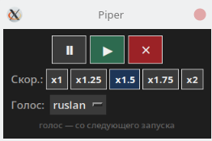

# Piper Speak

Офлайн-озвучка выделенного текста нейросетевым голосом [Piper](https://github.com/rhasspy/piper) для **Linux (Wayland) + KDE Plasma**.

Выделили текст → нажали горячую клавишу → появилось окошко синтеза → воспроизведение с паузой, скоростью и сменой голоса.



## Возможности

- Чтение **выделенного** текста (`primary selection`) или буфера обмена (`Ctrl+C`)
- Полностью **офлайн** (Piper + локальные `.onnx` модели)
- Прелоад с прогрессом на длинных текстах
- Управление: пауза / продолжить / стоп
- Скорость: `x1`, `x1.25`, `x1.5`, `x1.75`, `x2`
- Переключение русских голосов: `denis`, `dmitri`, `irina`, `ruslan`
- Повторное нажатие горячей клавиши останавливает озвучку

## Требования

- Linux с **Wayland** (проверялось на Arch Linux + KDE Plasma)
- `piper-tts` (пакет `piper-tts-bin` в AUR)
- `mpv`, `wl-clipboard`, `socat`, `python3` + `tkinter`
- `notify-send` (опционально, для уведомлений)

### Arch Linux

```bash
sudo pacman -S wl-clipboard mpv socat python tk alsa-utils
yay -S piper-tts-bin
# или: paru -S piper-tts-bin
```

## Установка

```bash
git clone https://github.com/vaajnur/piper-speak.git ~/piper-speak
cd ~/piper-speak
chmod +x speak.sh ui.py scripts/download_voices.sh
./scripts/download_voices.sh
```

Скрипт скачает русские голоса medium (~60 МБ каждый) из [rhasspy/piper-voices](https://huggingface.co/rhasspy/piper-voices) в `voices/`.

> Модели `.onnx` в репозиторий **не входят** (слишком крупные). Их нужно скачать отдельно.

## Горячая клавиша (KDE Plasma)

1. **Параметры системы → Клавиатура → Комбинации клавиш**
2. **Добавить команду…**
3. Команда:

```text
/home/ВАШ_ПОЛЬЗОВАТЕЛЬ/piper-speak/speak.sh
```

4. Назначьте сочетание, например `Alt+Shift+S`
5. **Применить**

Узнать домашний путь:

```bash
echo "$HOME/piper-speak/speak.sh"
```

## Использование

1. Выделите текст мышью **или** скопируйте через `Ctrl+C`
2. Нажмите горячую клавишу
3. Дождитесь синтеза (на большом тексте будет прелоад)
4. Управляйте озвучкой в плавающем окошке

| Кнопка / элемент | Действие |
|------------------|----------|
| ⏸ | Пауза |
| ▶ | Продолжить |
| ✕ | Стоп / отмена синтеза |
| x1 … x2 | Скорость (сразу + запоминается) |
| Голос | Смена голоса со **следующего** запуска |
| Горячая клавиша повторно | Полная остановка |

## Структура

```text
piper-speak/
├── speak.sh                 # точка входа для горячей клавиши
├── ui.py                    # окошко: прелоад + управление
├── piper-speak.png          # скриншот UI
├── voice.conf               # текущий голос (создаётся/меняется UI)
├── speed.conf               # текущая скорость
├── voices/                  # модели Piper (*.onnx + *.json)
├── scripts/
│   └── download_voices.sh   # загрузка русских голосов
└── README.md
```

## Настройки

Файлы рядом со скриптом:

- `voice.conf` — имя голоса, например `irina`
- `speed.conf` — скорость, например `1.5`

Их можно править вручную или через UI.

## Добавить другие голоса

1. Возьмите пару файлов с [Hugging Face — piper-voices](https://huggingface.co/rhasspy/piper-voices):
   - `xx_XX-name-quality.onnx`
   - `xx_XX-name-quality.onnx.json`
2. Положите их в `voices/`
3. Для автоподхвата UI сейчас ожидает шаблон:

```text
ru_RU-<имя>-medium.onnx
```

Для других языков/качеств нужно слегка поправить разбор имён в `ui.py` / `speak.sh`.

## Устранение неполадок

**Нет звука / ничего не происходит**

```bash
cat /tmp/speak_piper.log
```

**Команда `piper` не найдена**  
В Arch из AUR бинарник обычно называется `piper-tts` (`/usr/bin/piper-tts`). Скрипт уже использует его.

**Окно не появляется**  
Проверьте `python3` и tkinter:

```bash
python3 -c "import tkinter; print('ok')"
```

**Буфер пустой**  
На Wayland нужен `wl-clipboard`. Выделите текст или скопируйте `Ctrl+C` перед горячей клавишей.

## Лицензия

Код скриптов — MIT (можете заменить на свою).

Модели голосов Piper распространяются на условиях лицензий соответствующих датасетов/карточек моделей на Hugging Face; при публикации репозитория **не выкладывайте** `.onnx` без проверки лицензии каждой модели.
